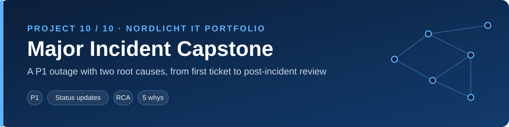

      

> [!NOTE]
> **Kurzfassung (DE):** Abschlussprojekt: eine **schwere Störung (P1)** mit **zwei unabhängigen Ursachen** in der Lab-Umgebung, durchgespielt von der ersten Meldung bis zur Ursachenanalyse. Montag, 07:05 Uhr: Niemand kann Netzlaufwerke öffnen, viele können sich nicht anmelden. Ursache 1: Die Systemplatte des Domänencontrollers ist voll (fehlgeleitete Sicherung). Ursache 2, erst nach der ersten Lösung sichtbar: eine **Zeitabweichung > 5 Minuten** bricht die Kerberos-Anmeldung. Dokumentiert: Zeitleiste, Statusmeldungen an alle Mitarbeitenden (DE/EN), technisches Protokoll, **Post-Incident-Review** mit 5-Why-Analyse und Maßnahmenplan. Inklusive Skripten, um die Störung im Lab nachzustellen.

This project brings everything together: AD and DNS ([01](https://github.com/BigDougCed/01-homelab-build), [02](https://github.com/BigDougCed/02-active-directory-gpo)), the service desk ([06](https://github.com/BigDougCed/06-helpdesk-ticketing-zammad)), monitoring and backup ([09](https://github.com/BigDougCed/09-linux-monitoring-backup)), and above all **communication under pressure**.

## Incident summary
| | |
|---|---|
| **ID** | MI-2026-001 (parent ticket INC-1030, 23 linked tickets) |
| **Date** | Monday 2026-11-23, 07:05–08:52 (impact 1 h 47 min) |
| **Priority** | P1: majority of staff unable to access files and, partly, to sign in |
| **Impact** | 19 of 25 users; file shares, printing via DC01, new logons. M365 (mail, Teams) unaffected |
| **Cause 1** | DC01 system drive full: nightly backup was temporarily redirected to `C:\Backup` (undocumented change) → AD DS and DNS stopped working correctly |
| **Cause 2** | DC01 clock 7 min fast: NTP source pointed to a decommissioned device; drift crossed the 5-minute **Kerberos** limit over the weekend → laptops with correct time were rejected |
| **Resolution** | Freed disk space, restarted AD DS/DNS; configured external NTP on the PDC emulator, resynced time |
| **Follow-up** | 9 corrective/preventive actions, see the [post-incident review](docs/05-post-incident-review.md) |

## Timeline at a glance

```mermaid
flowchart LR
    A["02.07<br/>Backup writes<br/>41 GB to C:"] --> B["03.41<br/>C: full, AD DS<br/>and DNS failing"]
    B --> C["06.10<br/>Alert by e-mail<br/>(unread)"]
    C --> D["07.05<br/>First ticket"]
    D --> E["07.22<br/>P1 declared<br/>Update 1"]
    E --> F["07.48<br/>Disk freed<br/>AD DS restarted"]
    F --> G["08.02<br/>Laptops fail Kerberos<br/>clock +7 min"]
    G --> H["08.14<br/>NTP fixed on<br/>PDC emulator"]
    H --> I["08.52<br/>All-clear<br/>Update 5"]
    classDef n fill:#0B1F3A,stroke:#5FB3FF,color:#fff
    classDef bad fill:#B42318,stroke:#F04438,color:#fff
    classDef good fill:#1B5E20,stroke:#66BB6A,color:#fff
    class A,C,D,E,F,H n
    class B,G bad
    class I good
```

## Documents
| # | Document | What it shows |
|---|---|---|
| 1 | [Scenario & impact](docs/01-scenario.md) | What users experienced, how it was detected |
| 2 | [Timeline](docs/02-timeline.md) | Minute-by-minute log from 02:07 to closure |
| 3 | [Communications](docs/03-communications.md) | 5 status updates (DE/EN) + the all-clear, management briefing |
| 4 | [Technical troubleshooting log](docs/04-troubleshooting-log.md) | Commands, findings, decisions |
| 5 | [Post-incident review (RCA)](docs/05-post-incident-review.md) | 5 whys for both causes, what went well/badly, action plan |
| 6 | [Lab exercise](lab/README.md) | Scripts to reproduce and repair the outage in the lab |

## What this project demonstrates
- **Pattern recognition**: 5 similar tickets in 15 minutes → declare a major incident instead of solving tickets one by one
- **Roles**: incident manager (communication, coordination) separated from technical lead (fixing)
- **Communication**: regular, plain-language updates to staff and management, also when there's nothing new
- **Not stopping at the first cause**: the second fault only appeared after the first was fixed
- **Blameless review**: focus on the process gaps (undocumented change, e-mail-only alerting, no NTP monitoring), not on the colleague

## Lab evidence
- [ ] Uptime Kuma: LDAP/DNS down, then recovered → `screenshots/kuma-outage.png`
- [ ] DC01 disk full (Explorer / `Get-PSDrive C`) → `screenshots/disk-full.png`
- [ ] Event 4 (KRB_AP_ERR_SKEW) on a client → `screenshots/kerberos-skew.png`
- [ ] `w32tm /stripchart` showing the offset, then 0 after the fix → `screenshots/w32tm.png`
- [ ] Zammad parent ticket with linked child tickets → `screenshots/zammad-parent.png`

## Skills shown
Major incident management (ITIL) · structured troubleshooting under time pressure · Active Directory / DNS / Kerberos · Windows time service (w32tm) · event log analysis · stakeholder communication in German and English · root cause analysis (5 whys) · CAPA planning · PowerShell

---

<a href="https://github.com/BigDougCed/09-linux-monitoring-backup">09 Linux, monitoring &amp; backup</a> &nbsp;·&nbsp; <a href="https://github.com/BigDougCed">Portfolio</a>

